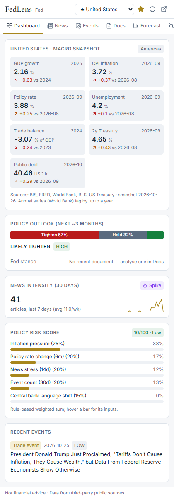
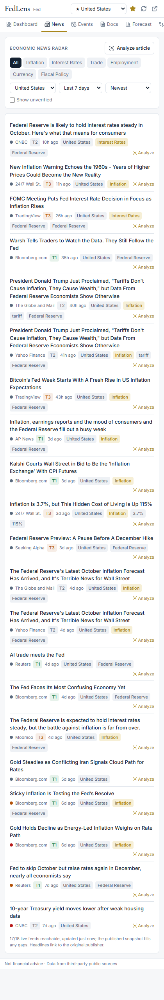
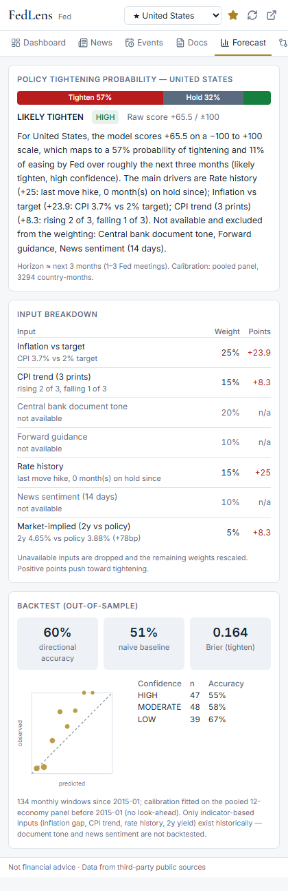
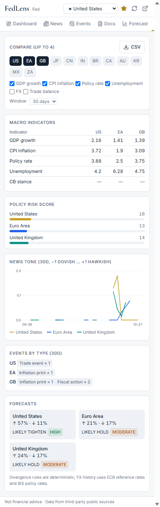
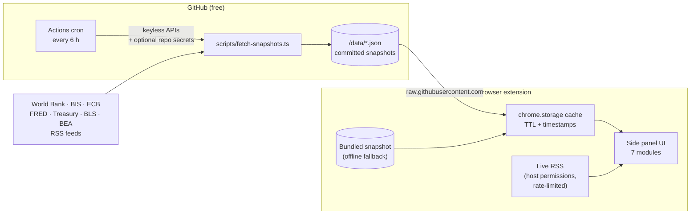
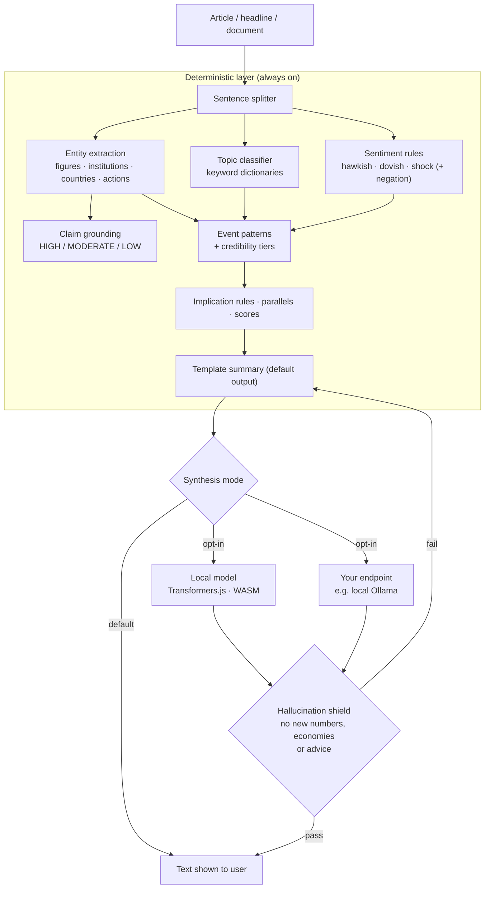

# FedLens

**Global macroeconomic intelligence in your browser.** Live indicators, a news radar with real NLP, event extraction, a calibrated policy forecast lab and side-by-side country comparisons for 12 economies — as a Manifest V3 extension for Chrome and Firefox.

Free to use and free to run: **no accounts, no backend, no paid APIs, no API keys.**

[](https://github.com/zayrhabeeb/FedLens/actions/workflows/ci.yml)
[](https://github.com/zayrhabeeb/FedLens/actions/workflows/refresh-data.yml)
[](LICENSE)

> **Disclaimer — not financial advice.** FedLens summarises data from third-party public sources (World Bank, BIS, ECB, FRED, US Treasury, BLS, central banks and news publishers). It may be incomplete, delayed or wrong. Forecasts are statistical estimates for research and education only.

| Dashboard                                    | News radar                               | Forecast lab                                   | Compare                                  |
| -------------------------------------------- | ---------------------------------------- | ---------------------------------------------- | ---------------------------------------- |
|  |  |  |  |

<!-- TODO: add docs/demo.gif — a 20-second walkthrough (Dashboard → Analyze article → Forecast). -->

---

## What it is

FedLens turns public macro data and central-bank communication into **structured, traceable signals**. Its design thesis is _deterministic first_: every number, label and score comes from transparent rules and real data you can inspect. Language models are optional and may only re-phrase what the rules already produced — and a hallucination shield rejects any output that adds a number, an economy or advice that isn't in the source facts.

**Economies:** United States · Euro Area · United Kingdom · Japan · China · India · Brazil · Canada · Australia · South Korea · Mexico · South Africa

## Features by module

| #   | Module                            | What it does                                                                                                                                                                                                                                                                                                                                                        |
| --- | --------------------------------- | ------------------------------------------------------------------------------------------------------------------------------------------------------------------------------------------------------------------------------------------------------------------------------------------------------------------------------------------------------------------- |
| 1   | **Country Dashboard**             | GDP, CPI, policy rate, unemployment, FX and trade balance tiles with deltas and good/mixed/bad colouring; news-intensity meter with spike detection; a 0–100 **Policy Risk Score** broken into its components; recent events; central-bank stance.                                                                                                                  |
| 2   | **News Radar + Article Analyzer** | Live central-bank and news RSS, de-duplicated and run through the NLP pipeline (country tagging, topics, entities, sentiment, source-credibility tiers). The analyzer reads the current tab or pasted text and returns grounded entity highlights, claim confidence, rule-based implications, **historical parallels from real data**, related coverage and a memo. |
| 3   | **Macro Event Extractor**         | Nine event types (rate decisions, inflation prints, GDP releases, fiscal, trade, currency shocks, elections, speeches, external shocks). Speculative or opinion headlines are filtered out; corroborating articles are merged; 3+ events in 7 days flag a high-activity window.                                                                                     |
| 4   | **Central Bank Documents**        | Upload a PDF/TXT or paste a statement (parsed locally with pdf.js). Quality gate, hawkish/dovish stance score, explicit vs conditional forward guidance, rate decision, dissent, and a **delta engine** comparing phrases against the bank's previous document. Decisions feed the event timeline and the forecast.                                                 |
| 5   | **Policy Forecast Lab**           | Probability of tightening / easing over ~3 months from seven weighted, explainable inputs, **Platt-calibrated on a 12-economy historical panel** and shown with an out-of-sample backtest (accuracy vs naive baseline, Brier score, calibration curve, accuracy by confidence tier).                                                                                |
| 6   | **Comparative View**              | Up to four economies side by side: indicators, stance, risk, news-tone chart, event counts and forecasts, plus a rule-based **Divergence Detector** (stance, cycle and shock divergence) with historical FX outcomes. CSV export.                                                                                                                                   |
| 7   | **Country Macro Brief**           | One-page brief assembled from all of the above. Export as Markdown or print to PDF.                                                                                                                                                                                                                                                                                 |

## Architecture

### Data flow — static snapshots, no backend



Upstream free tiers see a handful of requests per day _in total_, not per user. If the remote snapshot is unreachable, the extension serves its cache, then the snapshot bundled at build time — it always opens with data.

### NLP — deterministic first, synthesis optional



## Data sources

All endpoints used by default need **no authentication**.

| Source                 | Used for                                              | Endpoint                                                          | Auth needed                                                        |
| ---------------------- | ----------------------------------------------------- | ----------------------------------------------------------------- | ------------------------------------------------------------------ |
| BIS Data Portal        | Policy rates & CPI (12 economies, monthly since 2000) | `stats.bis.org/api/v2/data/dataflow/BIS/WS_CBPOL`, `WS_LONG_CPI`  | None                                                               |
| World Bank API         | GDP growth, unemployment, trade balance (annual)      | `api.worldbank.org/v2/country/…/indicator/…`                      | None                                                               |
| ECB Data Portal        | FX reference rates, euro-area HICP                    | `data-api.ecb.europa.eu/service/data/EXR`, `ICP`                  | None                                                               |
| FRED (St. Louis Fed)   | US CPI, 2-year Treasury yield                         | `fred.stlouisfed.org/graph/fredgraph.csv`                         | None (optional `FRED_API_KEY` secret switches to the official API) |
| US Treasury FiscalData | Total public debt                                     | `api.fiscaldata.treasury.gov/…/debt_to_penny`                     | None                                                               |
| BLS Public API v1      | US unemployment (monthly)                             | `api.bls.gov/publicAPI/v1/timeseries/data/`                       | None (optional `BLS_API_KEY` secret → v2, 20 years)                |
| BEA                    | US quarterly real GDP growth                          | `apps.bea.gov/api/data`                                           | Only if `BEA_API_KEY` secret is set; otherwise skipped             |
| Central bank RSS       | Fed, ECB, BoE, BoJ, BoC, RBA releases                 | official feeds (see [`src/shared/feeds.ts`](src/shared/feeds.ts)) | None                                                               |
| Google News RSS        | Per-country macro headlines (link to publishers)      | `news.google.com/rss/search`                                      | None                                                               |

Keys, when used, live only in **GitHub repository secrets** for the scheduled workflow. They are never in the repo, the extension or the user's browser. See [ATTRIBUTIONS.md](ATTRIBUTIONS.md) for terms and licenses.

## Install

### From a GitHub Release (recommended)

1. Download `fedlens-chrome-vX.Y.Z.zip` (Chrome, Edge, Brave, Arc) or `fedlens-firefox-vX.Y.Z.zip` from the [latest release](https://github.com/zayrhabeeb/FedLens/releases/latest) and unzip it.
2. **Chrome / Edge / Brave:** open `chrome://extensions`, enable **Developer mode**, click **Load unpacked**, and select the unzipped folder.
3. **Firefox:** open `about:debugging#/runtime/this-firefox` → **Load Temporary Add-on…** → select `manifest.json` in the unzipped folder. (For a permanent install, use the signed build from addons.mozilla.org once published.) On first run, open **Settings → Grant feed access** — Firefox asks for host access separately.
4. Click the FedLens toolbar icon to open the side panel (sidebar in Firefox).

### From source

```bash
git clone https://github.com/zayrhabeeb/FedLens.git
cd FedLens
npm ci
npm run build          # → dist/chrome and dist/firefox
```

Then load `dist/chrome` (or `dist/firefox`) as above.

## Development

Requires Node.js 22+ (CI uses 24).

| Command                | What it does                                                                                                             |
| ---------------------- | ------------------------------------------------------------------------------------------------------------------------ |
| `npm run dev`          | Vite dev server for the UI at `localhost:5173` (uses localStorage; live feeds fall back to the snapshot because of CORS) |
| `npm run build`        | Type-safe production builds for Chrome and Firefox                                                                       |
| `npm test`             | Vitest unit tests (NLP, parsers, cache/rate-limit, forecast, backtest, shield, manifest)                                 |
| `npm run lint`         | ESLint + Prettier check (`npm run format` to fix)                                                                        |
| `npm run typecheck`    | `tsc --noEmit`                                                                                                           |
| `npm run zip`          | Package `dist/*` into `release/fedlens-<browser>-v<version>.zip`                                                         |
| `npm run data:refresh` | Run the snapshot pipeline locally (writes `/data`)                                                                       |
| `npm run icons`        | Regenerate PNG icons (pure Node, no artwork assets)                                                                      |

### Project structure

```
src/
  shared/      types, country registry, CSV/RSS parsers, feeds (browser + Node)
  nlp/         deterministic NLP: lexicon, entities, topics, sentiment, events, documents
  forecast/    signals, calibrated model, walk-forward backtest
  analytics/   risk score, news intensity, divergence detector, historical parallels
  synthesis/   template drafts, hallucination shield, optional local / BYOK providers
  data/        chrome.storage cache, polite rate-limited fetch, snapshot + news loaders
  ui/          React side-panel app (one file per module)
  manifest.ts  generates Chrome and Firefox MV3 manifests
scripts/       snapshot pipeline (GitHub Actions), zip packaging, icon generator
data/          committed JSON snapshots (refreshed by the workflow)
```

### Using your own fork's data

The scheduled workflow commits fresh snapshots to `/data` in _your_ repository. Point the extension at them by editing one line in [`src/config.ts`](src/config.ts):

```ts
export const SNAPSHOT_BASE_URL = 'https://raw.githubusercontent.com/<you>/FedLens/main/data';
```

Optional secrets are described in [CONTRIBUTING.md](CONTRIBUTING.md#data-pipeline-secrets-optional).

## Optional synthesis (off by default)

- **Local model** — Settings → _Local model_. Downloads `Xenova/flan-t5-base` (Apache-2.0, ≈250 MB, once) and runs it on-device with Transformers.js / ONNX Runtime WASM. The runtime is bundled in the extension; only model weights are fetched from the Hugging Face Hub.
- **Your own endpoint** — Settings → _Your own endpoint_. Any OpenAI-compatible `/chat/completions` URL, such as a free local [Ollama](https://ollama.com) (`http://localhost:11434/v1`). An API key, if you enter one, is stored only in `chrome.storage.local` on your device and is sent only to the endpoint you configured.

Both modes are checked by the hallucination shield and fall back to the deterministic text on any failure.

## Privacy & permissions

FedLens has no server and collects nothing. See [PRIVACY.md](PRIVACY.md).

| Permission                                                          | Why                                                                                        |
| ------------------------------------------------------------------- | ------------------------------------------------------------------------------------------ |
| `storage`, `unlimitedStorage`                                       | Cache snapshots, the 30-day news archive and your analysed documents locally               |
| `sidePanel` (Chrome)                                                | Show the app in the side panel                                                             |
| `activeTab`, `scripting`                                            | Read the article in the current tab — only when you click _Analyze current tab_            |
| Host access to `raw.githubusercontent.com` and the listed RSS hosts | Fetch snapshots and live feeds without a third-party CORS proxy                            |
| Optional: `https://*/*`, `localhost`                                | Requested only if you analyse a page without the activeTab grant, or configure an endpoint |

## How good is the forecast?

The Forecast Lab always shows its own out-of-sample record. With the snapshot of 26 Oct 2026, testing 2015 onward with calibration fitted on pre-2015 data: the US model gets 60% directional accuracy vs a 51% "always predict the most common outcome" baseline; it beats the baseline in 10 of 12 economies, ties in China, and underperforms in Japan (years at the zero lower bound make "hold" hard to beat). Only indicator-based inputs exist historically, so document tone and news sentiment are not backtested. The UI says all of this next to the number.

## Roadmap

- [ ] Publish to addons.mozilla.org (free) and optionally the Chrome Web Store (one-time $5 developer fee)
- [ ] Demo GIF and short architecture walkthrough
- [ ] "Everyday" plain-language view mode
- [ ] Per-country forecast calibration and meeting-calendar-aware horizons
- [ ] Phrase-level monitors: alert when a central bank adds or drops a key phrase
- [ ] More official central-bank feeds (RBI, BCB, BoK, Banxico, SARB) as stable RSS becomes available
- [ ] PNG export for comparison charts
- [ ] Localised UI

## Contributing

Issues and PRs are welcome — see [CONTRIBUTING.md](CONTRIBUTING.md) and the [Code of Conduct](CODE_OF_CONDUCT.md). Security issues: [SECURITY.md](SECURITY.md).

## License

[MIT](LICENSE) © 2026 Zayr. Data and third-party components remain under their own terms — see [ATTRIBUTIONS.md](ATTRIBUTIONS.md).
